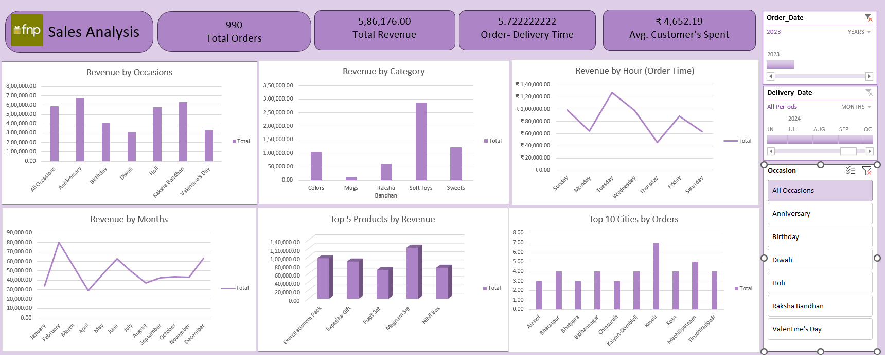

# Ferns & Petals (FNP) Sales Analysis

An end-to-end sales analysis project using Microsoft Excel, Power Query, and Power Pivot. It explores sales data for Ferns & Petals (FNP), an occasion-based gifting business operating across multiple Indian cities.

The project follows the analytics process from preparing the data to building an interactive dashboard, with the goal of understanding sales performance, products, customer spending, seasonal demand, location patterns, and delivery operations.

## Project Files

- `Dashboard/Dashboard.png` — preview of the sales dashboard
- `Data_Analysis/Sales_Analysis_project.xlsx` — Excel analysis workbook

## Dashboard Preview

The dashboard summarizes key performance indicators and provides charts for occasion and category revenue, revenue by order day and month, top products, and cities by order count. It also includes filters for order date, delivery date, and occasion.

## Business Questions

This analysis explores the following questions:

1. What was the total revenue?
2. How long did orders take to be delivered on average?
3. How did sales vary by month?
4. Which products generated the most revenue?
5. What was the average customer spend?
6. Which cities recorded the most orders?
7. How did revenue differ by occasion?
8. Did order quantity affect delivery time?

## Data Preparation and Modeling

### Power Query

Power Query was used to prepare the data for analysis. The process included removing duplicate or inconsistent records, standardizing date formats, setting suitable data types, and creating fields such as delivery duration, order month, and occasion group.

### Power Pivot

Power Pivot was used to connect the Orders, Products, Customers, and Dates tables. DAX measures were created for total revenue, total orders, average customer spend, average delivery time, and revenue by occasion and category.

## Key Findings

The results below are reported in the project workbook and dashboard.

### Overall Performance (2023)

- **Total orders:** 990
- **Total revenue:** ₹5,86,176
- **Average customer spend:** approximately ₹4,652
- **Average delivery time:** approximately 5.72 days

### Revenue by Occasion

Anniversary and Raksha Bandhan were the leading occasions by revenue, with Holi also contributing strongly. Diwali and Valentine’s Day showed comparatively lower revenue. These results may help guide occasion-focused promotions.

### Revenue by Category

Soft Toys generated the most revenue among the categories shown. Sweets and Colors made moderate contributions, while Mugs contributed the least.

### Monthly Sales

The dashboard shows higher sales in February, June, and December, with a dip around April. This seasonal pattern may help with planning inventory and campaigns around gifting occasions.

### Top Products and Cities

Gift sets and bundles feature among the top five products by revenue. The city order ranking also includes Tier-2 and Tier-3 locations, indicating that sales extend beyond major metropolitan areas.

## Order Quantity and Delivery Time

The reported average delivery time is about 5.72 days. The initial review did not show a clear increase in delivery time for larger order quantities. A formal correlation or regression analysis would be needed to test this relationship more conclusively.

## Tools and Skills

**Tools:** Microsoft Excel, Power Query, Power Pivot, DAX, PivotTables, PivotCharts, and dashboard filters.

**Skills demonstrated:** data cleaning and transformation, data modeling, KPI creation, translating business questions into metrics, dashboard development, and communicating business insights.

## Project Outcome

This project demonstrates an Excel-based analytics workflow, from preparing and modeling sales data to presenting results in an interactive dashboard. The analysis provides a way to explore commercial and operational patterns in the FNP sales data.
